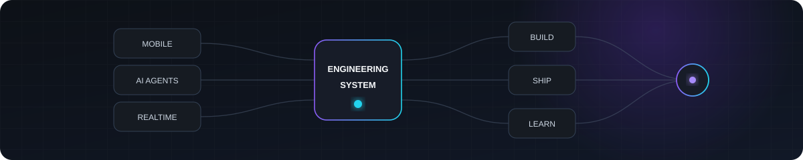

<h1 align="center">Ryosuke Shimizu</h1>

  <strong>Mobile &amp; Product Engineering · AI Agents · Realtime 3D</strong> 
  Android Tech Lead at <a href="https://avvy.live/en"><strong>AnotherBall</strong></a> · Tokyo, Japan

  I work across product design, technical planning, and implementation, with a foundation in mobile engineering.

  <a href="https://app.notion.com/p/rio432/Android-1c047dd696d6806fa200f7db09a64166">Resume</a>
  · <a href="https://speakerdeck.com/rio432">Talks</a>
  · <a href="./CAREER.md">Career</a>
  · <a href="https://x.com/rioX432">X</a>

<picture>
  <source media="(prefers-color-scheme: dark)" srcset="./assets/profile-systems-dark.svg">
  <source media="(prefers-color-scheme: light)" srcset="./assets/profile-systems-light.svg">
  
</picture>

## Now

### Building Avvy

Leading Android development and working across mobile, product design, and backend systems. My work includes shaping product requirements, evaluating technologies, planning implementation, and testing ideas through proof-of-concept work.

### Building with AI agents

Developing repeatable workflows for investigation, planning, implementation, review, and verification across multiple projects. I'm also exploring how AI-assisted workflows can support visual content creation.

### Exploring realtime 3D & creation tools

Researching avatar experiences, cross-platform rendering, and asset-production workflows that connect creative tools with interactive applications.

## Selected Work

### [agent-witness](https://github.com/rioX432/agent-witness)

**Observability and auditing for AI coding agents.**

A Rust tool that records agent sessions and makes delegation, tool usage, token usage, and potentially destructive operations inspectable.

`Rust` · `Claude Code` · `MCP` · `Agent Observability`

### [KMP-FaceLink](https://github.com/rioX432/KMP-FaceLink)

**A Kotlin Multiplatform SDK for face, hand, and body tracking.**

One tracking API that wraps MediaPipe on Android and ARKit / Vision on iOS, with experimental JVM and Wasm targets. Extension modules map blend shapes to VRM and Live2D parameters and connect to VRM apps and VTube Studio through VMC Protocol, iFacialMocap, and the VTube Studio Plugin API.

`Kotlin Multiplatform` · `MediaPipe` · `ARKit` · `Vision` · `VRM` · `Live2D`

### [CivitDeck](https://github.com/rioX432/CivitDeck)

**A native workspace for discovering and running generative AI models.**

A Kotlin Multiplatform application spanning Android, iOS, and Desktop, integrating Civitai, ComfyUI, local generation workflows, and on-device search.

`Kotlin Multiplatform` · `Compose` · `SwiftUI` · `ONNX` · `Core ML`

### [ai-dev-templates](https://github.com/rioX432/ai-dev-templates)

**Structured workflows and guardrails for agent-driven software development.**

Reusable patterns for investigation, decomposition, implementation, verification, review, and PR workflows with context-isolated agents and automated quality gates.

`AI Agents` · `Automation` · `Verification`

## Current R&D

These are ongoing research and prototyping areas; some work is not publicly available.

### Agentic Engineering

I'm building development environments around **context, memory, orchestration, review, observability, and verification**, so that work delegated to AI agents can be inspected and repeated.

### Cross-platform Visual Systems

I'm researching native GPU rendering, shared visual contracts, and automated visual evaluation across Android, Apple platforms, and Web. Current experiments include VRM avatar rendering and interactive character experiences.

This builds on my work with **MediaPipe, ARKit, RTC, Unity, Kotlin Multiplatform, and avatar systems**.

### Creative Production Workflows

I'm exploring how Blender, 3D asset preparation, and AI-assisted tooling can fit into repeatable production workflows. The focus is on connecting modeling, materials, and runtime integration, with prototypes used to evaluate technical choices and guide implementation.

## Talks

### DroidKaigi 2026

**[Overcoming accuracy limits of MediaPipe Face Landmarker](https://speakerdeck.com/rio432/overcoming-accuracy-limits-of-mediapipe-face-landmarker)**

A production-driven talk about improving face-tracking accuracy beyond the raw output of MediaPipe Face Landmarker.

[Session](https://2026.droidkaigi.jp/timetable/1236039/) · [Slides](https://speakerdeck.com/rio432/overcoming-accuracy-limits-of-mediapipe-face-landmarker) · [Video](https://www.youtube.com/watch?v=S79Mc9332bU)

### iOSDC Japan 2026 — Rookies LT

**Why is “puffing out your cheeks” detected so accurately? / 「ほっぺを膨らませる」が高精度なのはなぜ？**

A five-minute lightning talk about why facial-expression tracking can behave differently across iOS and Android.

[iOSDC Japan 2026](https://iosdc.jp/2026/) · [Speaker Deck](https://speakerdeck.com/rio432)

## Engineering

**Product & Technical Planning**  
Product design · Requirements · Technology evaluation · Implementation planning · Prototyping

**Mobile**  
Kotlin · Swift · Android · iOS · Jetpack Compose · SwiftUI · Kotlin Multiplatform

**AI Engineering**  
Claude Code · Codex · MCP · Agent orchestration · Subagents · Evaluation · Verification

**Realtime & Graphics**  
MediaPipe · ARKit · RTC · Camera / Audio · Unity · GPU rendering

**Backend & Cloud**  
Kotlin · Spring Boot · Firebase · REST APIs

## Background

8+ years building mobile products across **Topcon → LY Corporation → AnotherBall**, with additional hands-on experience in iOS, backend systems, and technical leadership.

See [CAREER.md](./CAREER.md) for the full career history.
